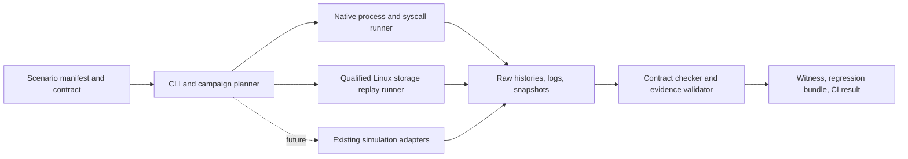

# Architecture specification

Status: proposed v0.1 architecture. Only the native wrappers, single-file experimental model, common evidence exporter, and baseline integrations have been executed. All other capabilities below are requirements or planned implementations.

**The common layer owns contracts, campaigns, and evidence. Execution backends own scheduling and their own failure semantics.** An event schema should describe what was observed and controlled; it should not pretend Rust tasks, Go goroutines, and Linux processes have one interchangeable scheduler.

## Boundaries and components



| Module | Owns | Must not claim |
|---|---|---|
| `scenario` | Parse manifest, paths, resource budgets, versioned schemas | A complete behavioral specification from metadata |
| `driver` | Launch ordinary workload/checker executables; collect client observations | Knowledge of internal commit points unless instrumented |
| `campaign` | Workload seeds, fault plans, budgets, candidate selection, retries | Exhaustive coverage from random sampling |
| `runner-native` | Process groups, termination, isolated data paths, logs; existing syscall injection integration | Power loss or deterministic thread scheduling |
| `runner-storage` | Capture/replay on a declared filesystem/block profile; fresh recovery instances | All possible storage behavior or hardware-firmware correctness |
| `contracts` | Initial durable prefix, operation outcomes, allowed recovery states, custom checker invocation | Correctness of an unreviewed customer oracle |
| `evidence` | Content hashes, artifact validation, provenance, capability and completeness checks | Stronger evidence than the originating backend provides |
| `reduce` | Minimize workload and selected persistence choices while preserving a failure | A global minimum or validity of a changed contract |
| `report` | Local readable summary, machine JSON, CI exit and regression instructions | A green badge without scope, assumptions, and tested budget |

Keep these in one Rust workspace and one CLI initially. A database service, distributed control plane, and plugin framework are unnecessary for the first external users. Python in the delivered research probe is an intentional experimental convenience, not an architectural dependency.

## Scenario interface

Use YAML/JSON for orchestration metadata and normal code for behavior. Illustrative v0.1 manifest; it is not implemented by the supplied probe:

```yaml
schema: adversary.scenario.v1
id: durable-batch
boundary:
  service: ./bin/service
  data_directory: ${ADVERSARY_DATA}
  persistent_external_dependencies: []
driver: [./test/workload]
recover: [./test/recover-and-query]
checker: [./test/check-recovery]
contract:
  id: acknowledged-batch-survives/v1
  acknowledgment: client-observed-success
  pending: may-commit-or-abort-atomically
execution:
  backend: linux-storage-replay
  profile: ext4-ordered-kernel-pinned-flush-honored/v1
budget:
  wall_seconds: 600
  max_recovery_images: 200
```

The resolved profile includes exact guest kernel, filesystem version/features, mount options, logical/physical sector assumptions, capture tool, replay policy, and declared unsupported effects. A profile name alone is insufficient. Driver communication is bounded NDJSON on dedicated pipes; diagnostic stdout/stderr is separate. Checkers receive a frozen observation file and return structured verdicts. The first shipping native runner may consume existing Faultbox specs rather than reimplement syscall policy.

Required user-supplied boundary information: what counts as a client acknowledgment; where durable state lives; whether external storage is involved; how to restart; how to read recovered state; and which outcomes are acceptable for uncertain calls. A retry with the same request ID is not automatically a new logical operation.

## Contracts and state

For the first contract, initialize a known durable state, perform a finite sequence of transactions/batches, interrupt execution, recover, and compare observable state with the accepted prefix or model. Assign every logical operation a stable ID and retain request content or a hash plus retrievable payload. Multi-key atomicity belongs to a transaction boundary, not to per-key checkers.

Outcome semantics:

- `ok`: the client observed a success response; the contract states what that response promises.
- `rejected`: evidence establishes no logical effect occurred, under the particular API contract.
- `unknown`: timeout, disconnect, or interrupted request; it may have taken effect. Preserve it as a possible operation rather than deleting it.
- `pending`: invocation observed, response unavailable at the crash boundary.

Start with sequential workload histories and an allowed recovered-state predicate. Add linearizability through a Porcupine sidecar when a customer needs concurrent operations. A sidecar avoids a premature Rust reimplementation. Use Elle only when transaction histories expose the dependencies required by its checker. Global invariants such as balanced accounts need application-specific checks even when individual reads/writes are linearizable.

Safety is a finite bad-state claim: acknowledged data lost, forbidden partial transaction, contradictory read, or invalid recovery. A recovery deadline is a bounded responsiveness property. State its timer source, healed-fault period, retry policy, and permitted assumptions. Failure to recover before a test deadline is a bounded failure or an inconclusive timeout, depending on whether the contract explicitly includes that bound. It is not a proof of infinite non-progress. General temporal logic and fairness verification are unsupported in v1.

## Shared evidence format

Use a small versioned envelope, not an all-purpose effect IR:

```json
{
  "schema": "adversary.evidence.v1",
  "contract": {"id": "durable-batch/v1", "hash": "..."},
  "subject": {"binary_hash": "...", "revision": "...", "config_hash": "..."},
  "execution": {"backend": "...", "profile_hash": "...", "capabilities": []},
  "history": "history.ndjson",
  "search": {"strategy": "sampled", "seed": 7, "budget": {}, "coverage": {}},
  "result": {"outcome": "violation", "evidence_kind": "native-observation"},
  "assumptions": [],
  "uncontrolled": ["native scheduling"],
  "completeness": {"history": "complete", "capture": "qualified-profile"},
  "witness": {"snapshot_hash": "...", "recovery_command": []},
  "replay": {"guarantee": "storage-image-recovery", "attempts": 5, "reproduced": 5}
}
```

History events need `run_id`, `operation_id`, `process_epoch`, `client_id`, `kind`, payload, local monotonic timestamp, and a monotonically increasing sequence number from the recording controller. Event kinds initially include invoke, response, fault-requested, fault-confirmed, crash, restart, recovery-observation, and checker-result. Requested faults that never land must not count as exercised cases. Establish cross-client order at a single controller or retain clock uncertainty; never order independent machine wall clocks as if synchronized.

Keep backend-specific traces as extensions. A storage effect can include file/inode identity, offset, length, data hash, operation completion, and persistence dependencies. A simulation trace can include task choices. These are not interchangeable. Maintain process epochs so a reused PID or restarted goroutine set cannot inherit an earlier lifetime's identity.

Result algebra:

| Outcome | Required evidence |
|---|---|
| `violation` | Witness and failed contract, with scope and fault-profile assumptions |
| `no_violation_observed` | Completed sampled tests, explicit count/budget and uncontrolled behaviors |
| `bounded_no_violation` | Declared finite domain, complete enumeration, qualified semantics, no dropped observations, and no unfinished checker jobs |
| `inconclusive` | Missing history, unsupported effect, exhausted checker time, ambiguous oracle, capture failure, or unqualified model |

Evidence kind is independent of outcome: native observations, modeled environment with production code, explicit-state model checking, or formal proof supplied by another tool. A Kani result must carry harness, unwind/completeness conditions, tool version, and assumptions; it cannot upgrade a native campaign's conclusion. An invalid environmental assumption invalidates the campaign claim even if the checker printed success.

## Execution and fault semantics

### Native runner: first useful milestone

Run actual production binaries and dependencies in a disposable environment. Terminate only the declared process group; restart against the surviving data path. Inject selected error returns/delays using existing tools. Retain native goroutine preemption, threads, atomics, allocation, clocks, entropy, and kernel scheduling as uncontrolled. Replaying a workload seed reproduces inputs, not the execution.

`SIGKILL` discards process memory and skips destructors. It retains kernel page cache, device state, and other processes. `EIO`/`ENOSPC` returns are separate faults; callers may observe partial writes or uncertainty, so fault specifications must state the intercepted boundary and return convention. A denied `fsync` is not equivalent to successful `fsync` followed by lost data.

### Qualified storage runner: critical validation work

Reuse a disposable Linux VM, real filesystem, and existing block capture/replay tooling such as `dm-log-writes`/`replay-log`. The kernel target records completed writes around flushes and special handling for FUA; treating the log as an arbitrary bag of writes would be incorrect. [Kernel documentation](https://docs.kernel.org/admin-guide/device-mapper/log-writes.html).

Record a small workload plus trusted external acknowledgment journal, retain the baseline disk image, map client milestones to capture marks, reconstruct selected persistence-consistent disk states, and boot/recover a fresh instance for each. No recovery instance may inherit page cache from the capturing system. Correlate acknowledgment marks with completed persistence barriers; marks must not introduce application fsyncs. Qualify this correlation with litmus tests before using it for customer evidence. The target kernel/module availability, guest lifecycle, log completeness, flush/FUA handling, and mark ordering are critical-path work, not solved by this report.

First production profile: one local data volume, one pinned Linux/filesystem configuration, honest completed flushes/FUA, fail-stop power loss, declared sector atomicity, and a small number of persistence cuts. A selected log-prefix campaign is sampled persistence exploration. It does not enumerate every partial/reordered/torn state. Do not advertise arbitrary-filesystem correctness, SSD firmware verification, corruption after successful flush, or full-system deterministic replay.

The research probe bypasses the filesystem and reconstructs one pre-existing file from successful positional writes and sync calls. It intentionally excludes namespace persistence and is not a substitute for the above runner. Its model must remain labeled experimental.

### Optional simulation adapters

Rust: use Turmoil for compatible Tokio networks/filesystem shims, MadSim for already integrated async systems, and Loom/Shuttle for localized concurrency. `std::thread`, ordinary `std::sync`, FFI, blocking I/O, external services, and bypassed filesystem imports do not become controlled merely because a Tokio test runs on one thread. Prefer a small existing `StorageBackend` interface, as redb exposes, when it is actually the right boundary.

Go: use a pinned Gosim toolchain when source translation and supported syscall semantics fit. Channels, maps, synchronization, OS calls, and runtime hooks require the adapter's control. Test `unsafe`, assembly, cgo, address-derived behavior, and unsupported syscalls explicitly; otherwise mark them outside scope. `testing/synctest` supplies useful fake-time concurrency tests, not storage virtualization or replay.

Cross-language native services can participate in one scenario using ordinary network protocols and one external history. Independent in-process Rust and Go simulators cannot automatically share a coherent virtual clock or deterministic global schedule. Keep that composition unsupported until a real customer justifies it. Wasmtime/WASI remains an optional future backend for already-compatible components; compilation targets, host calls, threads, filesystem and dependency behavior would still need qualification.

## Search, reduction, and replay

Begin with short, generated sequential workloads; sample persistence cuts around commit/checkpoint transitions; retain historical failures as a priority queue; randomize budgets across workload shapes. Deduplicate byte-identical recovery images within one profile and contract, not arbitrary hidden application states. The supplied probe performs this limited image deduplication.

Reduce a failure by first removing operations, then fault windows, then payload size and retained persistence choices. Re-run the reduced candidate multiple times. A reduction that no longer lands its fault or changes an unknown operation to rejected is invalid. Report a reproduction frequency for native failures rather than promising perfect replay. Store exact images for recovery replay; never reuse an already recovered mutable image as the original witness.

DPOR is deferred. Adding it later requires controlled enabled transitions, sound dependency/enabling relations, stable event identities, deterministic replay to branch points, and a declared memory model. Different application keys may share a WAL, page, lock, allocator, or flush domain. Their names alone are not a sound independence test. Persistence-graph enumeration and concurrency DPOR are different problems.

## Artifacts, CI, and isolation

Use a local directory bundle containing manifest, hashes, raw history, fault confirmations, checker output, witness images or references, logs, and a plain report. Use content-addressed object storage plus a small relational index only when sharing becomes necessary. Keep failure metadata and explicit regressions; expire routine successful-run logs according to a documented retention policy. Do not upload source or disk images by default.

Proposed CLI exit codes: 0 = completed requested scope with no violation; 1 = violation; 2 = inconclusive; 3 = invalid scenario/tool failure. The report always contains the richer verdict. PR jobs run known regressions and a short sampled budget; nightly runs explore more states. A checker timeout never becomes a pass. Promotion of a failure to a checked-in regression requires a human-reviewed contract and an explicit backend/profile pin.

Run untrusted customer binaries and checkers in per-job disposable VMs with limited egress, resource quotas, isolated storage, and no ambient credentials. Namespace/seccomp fault injection is an execution mechanism, not a sufficient multi-tenant security boundary. Avoid privileged device-mapper operations on developer host disks. The runner must accept only job-created disk images/devices, verify identities, and destroy the VM rather than risk changing host mounts. BYOC agents use narrowly scoped object-storage credentials; histories and snapshots may contain customer secrets. Treat retention, redaction, access control, and artifact integrity as product requirements.

The long-term autonomous interface is `run → inspect witness → propose change → rerun regression and nearby cases`, using the same structured evidence. Agents may author workloads or candidate invariants, but a self-generated oracle does not independently establish the requirement. No agent-specific execution runtime is required.

