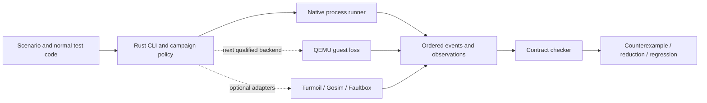

# System and interface specification

Status: fixed V1 target plus implemented native preview. Requirements below say explicitly where the code stops.

## Module ownership



The implemented workspace contains a small wire-protocol crate, a Rust SDK, and one CLI/library crate. The Go SDK implements the same wire protocol. Avoid separate network services and dynamically loaded plugins at this stage. A future backend is an executable or explicit Rust module with a versioned capability descriptor, not code loaded into the SUT's runtime by the common core.

The common engine owns scenario validation, case generation, IDs, budgets, history recording, oracle invocation, result semantics, reduction and report assembly. An execution adapter owns node lifecycle, failure controls, snapshots, scheduling if any, and backend trace details. A checker cannot upgrade the backend's evidence class.

## Adapter protocol v1, implemented

Transport: LF-delimited JSON over stdin/stdout, protocol version `v=1`, maximum frame 1 MiB. Only protocol frames belong on stdout; diagnostics belong on stderr. One request is in flight per adapter process. IDs identify logical operations within a case, not PIDs or goroutine identities.

Controller request:

```json
{"v":1,"id":"op-3","method":"apply","params":{"batch":{"a":"new","b":"new"}}}
```

Accepted response:

```json
{"v":1,"id":"op-3","kind":"response","result":{"accepted":true}}
```

A response with an `error` is unclassified adapter/application failure in this preview and makes the case inconclusive. It is not silently counted as an operation that did not happen. Future supported `rejected` outcomes require a reviewed no-effect meaning for that API.

Three methods form the first preset:

| Method | Request | Required behavior |
|---|---|---|
| `initialize` | `params.state`: string-valued baseline map | Establish a known baseline with the application's real persistence protocol; return accepted success |
| `apply` | `params.batch`: atomic map update | Apply the entire batch as one logical operation; return accepted only at the declared success boundary |
| `observe` | `params.keys`: all contract keys | Return a direct object containing every key, with a string value or `null` for observed absence |

Before testing, the controller observes and validates the baseline. Initialization is not repeated during recovery. Capture and recovery are different process epochs against the same case data directory. On malformed/incomplete observation, panic, timeout or missing response, the preview is inconclusive unless a supported typed property provides stronger evidence. Explicit absence within a complete observation can be a counterexample.

This map interface is one named contract preset. The long-term protocol keeps `method` and `params` application-owned; transaction histories, queue operations and custom state predicates must not be forced into key/value semantics. The next custom contract extension is an out-of-process checker receiving frozen history/observations and returning a typed verdict. Do not create a general specification language to add it.

## Cooperative checkpoint

An SDK checkpoint emits:

```json
{"v":1,"id":"op-3","kind":"checkpoint","name":"after-first-write"}
```

The adapter waits for a matching `continue` control frame. The controller either continues or confirms termination of its owned process group with `SIGKILL`. The operation has no success response if killed there, so it is unknown/pending. Its final state may be before or after the whole batch; a mixed state is disallowed. A requested checkpoint that does not occur is inconclusive even if the operation otherwise succeeds.

This handshake is optional test instrumentation. It controls that boundary, not kernel/runtime scheduling around the entire program. Keep it in test adapters, existing failpoint interfaces, or test-only builds. Never present a test-only altered implementation as an identical production binary without stating the change.

## Manifest, implemented fields

```toml
schema = 1
name = "durable-batches"
backend = "native-process"

[adapter]
command = ["./target/release/my-adapter"]

[contract]
kind = "atomic-map"
[contract.initial]
a = "0"
b = "0"

[campaign]
seed = 11
cases = 3
operations = 3
timeout_ms = 5000
wall_time_ms = 60000

[fault]
kind = "checkpoint"
checkpoint = "after-first-write"
```

`after-ack` is the other implemented fault kind and takes no checkpoint name. Adapters may receive explicit environment variables through `[adapter.env]`; the CLI supplies the data directory itself. Paths are resolved against the manifest directory. `ADVERSARY_DATA_DIR` is an absolute case-specific path. Unknown config fields and unimplemented backends are errors; there is no automatic capability downgrade.

The preview generator varies deterministic payload values by seed and operation ID; it does not explore schedules or claim broad workload diversity. Generated cases target the final operation. Beta adds an explicit checkpoint/operation-position matrix and customer workload generators while retaining the exact generated operations in the artifact.

## Contract and checking semantics

Maintain a reference state from all acknowledged operations before the crash. For one pending batch, allow exactly the prior state or that state with the whole batch applied. Do not partition an atomic multi-key batch into per-key correctness checks. A new case always starts with a fresh baseline; reduction recomputes the model from that baseline and the retained operations.

Liveness is excluded from the first preset. A protocol/recovery timeout produces inconclusive evidence. A later bounded recovery-deadline property must define healed-fault conditions, clock source and allowed duration; it cannot prove infinite liveness or fairness.

Later checker choices are fixed: Porcupine for finite concurrent linearizability when histories and pending outcomes fit its interface; Elle for supported transaction histories with sufficient dependency visibility; Loom/Shuttle or Kani only for appropriately bounded components. Keep original tool outcome, assumptions and completeness conditions. Use subprocess boundaries before reimplementing checkers in Rust.

## Evidence and result model

The native preview stores `run.json`, per-case `result.json`, capture/recovery event journals and stderr. Journals have controller sequence numbers and relative monotonic time within each process epoch. The report stores resolved configuration, exact operations, executable hash, acknowledgments, pending ID, required state, observation, confirmed fault and elapsed time. Capture gaps are explicitly marked with incomplete history.

V1's finalized envelope should add contract hash, backend/profile hash, dependency/artifact manifest, controller/OS versions, fault requested/landed counts, artifact hashes, skipped budgets and stable regression identity. The preview's top-level executable hash is not a dependency closure; do not treat it as one. Full environment capture is a release task, not an implemented guarantee.

| Outcome | Meaning |
|---|---|
| `violation` | A supported predicate failed on an observed execution/outcome, with its assumptions and witness |
| `no_violation_observed` | Requested sampled scope completed without a discovered violation |
| `inconclusive` | Requested evidence could not be established; includes missing faults, incomplete protocol, timeouts and unsupported effects |
| `bounded_no_violation` | Future only: complete finite domain, sound profile and no unfinished observations/checks |

Exit codes are 0/1/2 for the first three and 3 for invalid scenario/tool failure. A run containing a violation and unfinished cases reports the violation plus inconclusive counts; it does not claim complete coverage. A search budget exhausted before the remaining cases are attempted cannot produce a no-violation result for those cases.

## Replay, shrinking and durable regressions

Native replay repeats exact input operations; checkpoint replay repeats a selected cooperative fault boundary. Simulator replay requires the backend's full pinned execution inputs, dependency closure and controlled-effect coverage. Saved-image replay starts each recovery from a fresh copy of the witness. Instruction-level replay is unsupported by Adversary's native backend.

The preview checks the top-level executable hash for unchanged-artifact replay. `--allow-changed --manifest fixed.toml` explicitly evaluates a different implementation/configuration while enforcing the same contract, fault and backend. Do not silently change expectations to get a passing fix.

Greedy reduction removes operations while preserving the fault operation ID and a reproduced violation. Its budget is explicit; it does not claim a global minimum. The demonstration reaches one operation from three. A production reducer also tests payload and fault choices, lands the selected fault on every trial, and records reproduction frequency.

For release, store a stable regression file independent of a run ID: scenario and contract hashes, retained operations, named fault, compatible backend profile and artifact requirements. CI reconstructs a fresh environment and evaluates the current build. Local preview run directories retain absolute executable paths, so relocation requires a replacement manifest. Portable regression packaging remains an explicit backlog item.

## Storage and hosted evolution

Local files first. Use content-addressed blobs for logs/images and Postgres metadata only when team history exists; do not build a distributed database for orchestration. A later BYOC worker leases jobs, streams status and uploads only selected authorized artifacts. The hosted coordinator never needs to sit in the correctness-critical event path.

Initial paid execution uses customer-provisioned isolated runners. Add managed execution after resource metering, quota enforcement, secrets isolation, egress controls and retention are validated. Trusted local subprocesses are not the security architecture for a public multi-tenant service.

The future agent interface is the CLI and structured evidence. An agent can generate candidate checks or fixes, but cannot approve its own inferred requirement as independent proof. No agent-specific runtime is necessary.
